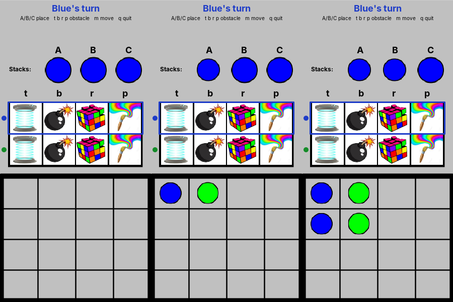
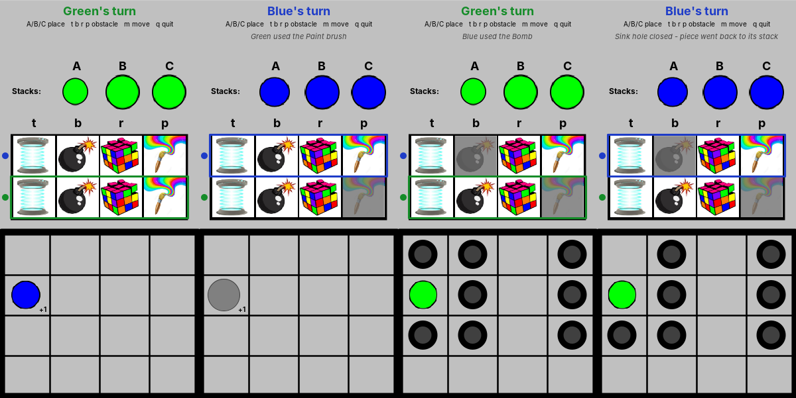
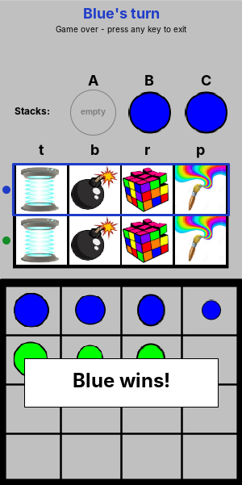

<<<<<<< HEAD
# Stacked Tic-Tac-Toe

A two-player, keyboard-driven twist on tic-tac-toe, written in Java. Pieces **stack** on top of each other on a 4×4 board, and each player has four **obstacles** that can wreck the other player's plans. It ships with a graphical mode and a deterministic text mode that replays a game from a file, which is what the automated tests use.



## Features

- **Graphical mode** (Java / StdDraw): turn-taking, stacking, piece moving, obstacles, win and draw detection, all from the keyboard.
- **Text mode**: replays a move file and prints the board after every move plus end-of-game statistics, so games are reproducible and testable.
- **Four obstacles**, each usable once per player in the GUI:

  | Key | Obstacle | Effect |
  |-----|----------|--------|
  | `t` | Transporter | Moves pieces from the top of an opponent's stack to open squares |
  | `b` | Bomb (sink hole) | Removes the target's top piece and the pieces around it (the board wraps around), sends them back to their owners' external stacks, and leaves sink holes in the empty squares |
  | `r` | Rubik's shifter | Rotates the pieces surrounding an empty square, clockwise or anti-clockwise |
  | `p` | Paint brush | Greys out an opponent's piece so it can't be moved |

- A **win** is four of your pieces in a row, column or diagonal, counting only the piece on top of each stack. If both players complete a line on the same move, it's a draw.



## Controls (GUI)

| Key | Action |
|-----|--------|
| `A` `B` `C` (or `1` `2` `3`) | Pick one of your three external stacks to place a piece from |
| `t` `b` `r` `p` | Use an obstacle |
| `m` | Move one of your pieces that is already on the board |
| `w` `a` `s` `d` | Move the cursor |
| `Enter` | Confirm the square under the cursor |
| `x` | Cancel the current action |
| `q` | Quit |

The top row of the obstacle panel belongs to Blue and the bottom row to Green; used obstacles are greyed out. Using an obstacle illegally still costs you that obstacle.



## Build and run

Requires JDK 11 or newer.

```bash
./build.sh        # compile into ./out
./run-gui.sh      # play
./run-tests.sh    # run the 24 text-mode test cases (add -v to show diffs)
```

On Windows use `build.bat` and `run-gui.bat`.

### Text mode

```bash
java -cp out StackedTicTacToe tests/input6.txt
```

Each line of the input file is one move. Blue and Green alternate, Blue first:

| Line | Meaning |
|------|---------|
| `S R C` | Place the next piece from external stack `S` (1-3) on row `R`, column `C` |
| `4 R C R2 C2` | Move the piece at `(R, C)` to `(R2, C2)` |
| `5 T R C N` | Transporter on `(R, C)`, moving `N` pieces |
| `5 B R C` | Bomb on `(R, C)` |
| `5 S R C D` | Shifter on `(R, C)`; `D` is `0` for clockwise, `1` for anti-clockwise |
| `5 P R C` | Paint brush on `(R, C)` |

## Project layout

```
src/        game source (StackedTicTacToe.java) + StdDraw / In helper classes
assets/     piece and obstacle images (the GUI loads them relative to this folder)
tests/      24 input/expected-output pairs and a description of each case
docs/       screenshots used in this README
```

## Status

- The GUI has been exercised end to end with scripted play-throughs (placing, stacking, moving, paint, bomb, sink holes, win, quit).
- Text mode currently passes **11 of 24** test cases. The failing ones are edge cases in the Transporter (tests 1, 5-8), paint-brush grey expiry (20-24), and a few stacked-piece cases for the bomb and shifter (2, 11, 18).
- Known limitation: the GUI does not yet expire the paint brush after three turns.

## Credits

`StdDraw.java` and `In.java` are from Princeton's *Introduction to Programming in Java* library by Robert Sedgewick and Kevin Wayne.
=======
# 🎮 Stacked Tic-Tac-Toe

A Java twist on classic Tic-Tac-Toe: instead of one mark per cell, each cell holds a **stack** of pieces. Players can also deploy special obstacle pieces to disrupt their opponent's board — turning a simple grid game into a layered strategy game.

## ✨ Features

- **Stacked cells** — each of the 16 board cells holds a stack, not just a single piece
- **Special moves / obstacles:**
  - 💣 **Bomb** — clears an opponent's stack from a cell
  - 🚀 **Transporter** — moves a piece between cells
  - 🎨 **Paint Brush** — repaints an opponent's piece
  - 🔀 **Shifter** — pops the top of a stack, revealing what's underneath
- **Two ways to play:**
  - **GUI mode** — a Swing/`StdDraw`-based visual board with keyboard navigation
  - **Text mode** — a console-driven version that reads moves from an input file, useful for automated testing

## 🕹️ How to Run

**GUI mode:**
```bash
javac SU_25433423.java
java SU_25433423
```

**Text mode** (reads moves from a file):
```bash
javac SU_25433423.java
java SU_25433423 <input-file>.txt
```

## 🧰 Built With

- Java (core game logic, `Stack<String>` data structures)
- Swing + `StdDraw` (Princeton's standard drawing library) for the GUI

## 📚 Background

This started as a university assignment exploring stack-based data structures, and grew into a full two-player game with a graphical interface, custom obstacle mechanics, and win/draw detection.

## 🚧 Known Limitations / Roadmap

- Refactor duplicated turn-handling logic between the two players into shared methods
- Replace raw coordinate variables with structured board-state objects
- Add unit tests for win/draw detection logic
>>>>>>> 7cb6c33d76ed4420ef510e7a44caf0e28bf6a899
